

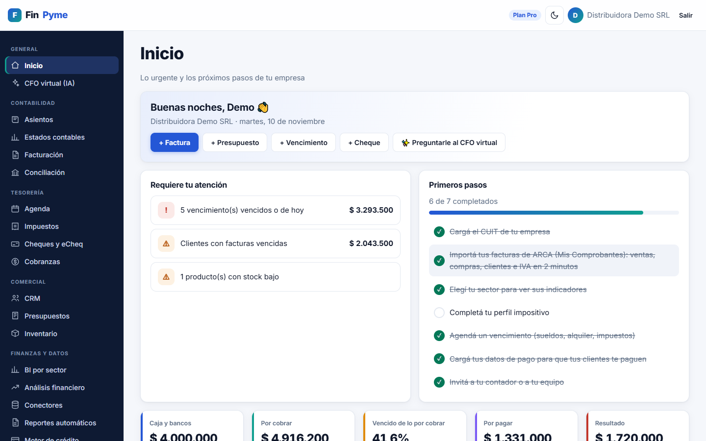

# FinPyme

**Finanzas, contabilidad e impuestos para pymes argentinas, en una sola plataforma web.**

### [▶ Probar la demo en vivo](https://finpyme-demo.onrender.com)

Entrá con «Ver la demo sin registrarte». Está en un servidor gratuito: la primera visita puede tardar hasta un minuto en despertar.

---

> **In English:** FinPyme is a SaaS for Argentine small businesses that brings bookkeeping, taxes, cash flow, cheques,
> collections, credit scoring and sector BI into one web app. It imports invoices from the tax authority (ARCA), reads
> invoice QR codes from photos, queries the Central Bank debtor registry, and sends reminders by WhatsApp or push
> notifications. Built with Python, FastAPI, SQLAlchemy and PostgreSQL, with 270+ automated tests running on SQLite and
> PostgreSQL in CI. **Source code is private**; this repository is a showcase.

## El problema

Una pyme argentina lleva la contabilidad en una planilla, los cheques en un cuaderno, los vencimientos de ARCA en la
cabeza y las cobranzas por WhatsApp. FinPyme junta todo eso: registra cada operación una sola vez y de ahí salen los
asientos, el IVA, el flujo de caja, los avisos y los indicadores del negocio.

## Capturas

| | |
|---|---|
| 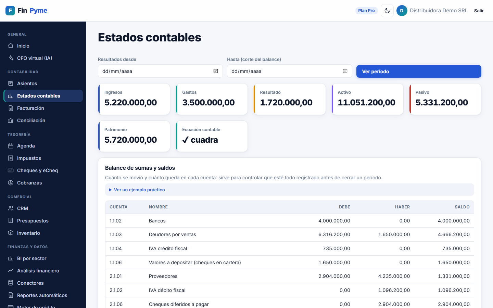 **Estados contables** con balance de sumas y saldos y control de la ecuación contable | 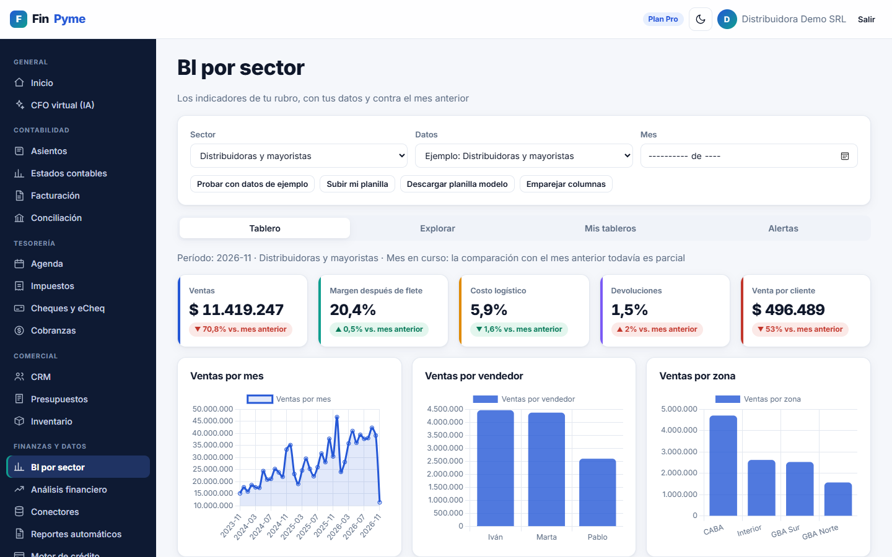 **BI por sector**: indicadores del rubro comparados con el mes anterior |
| 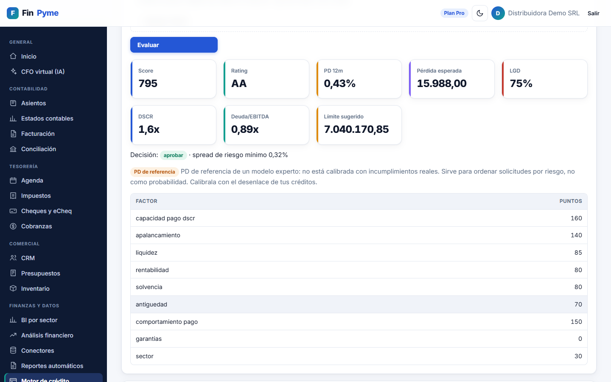 **Motor de crédito**: score, rating, PD, pérdida esperada y límite sugerido, con el aporte de cada factor | 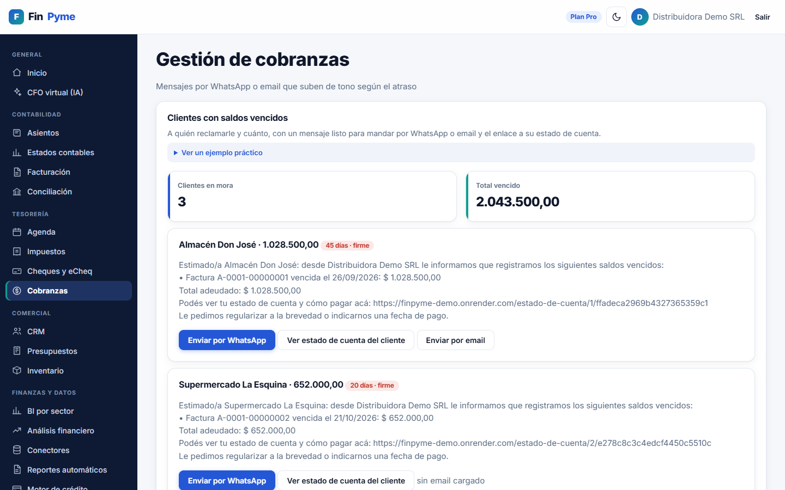 **Cobranzas**: mensajes por WhatsApp o email que suben de tono según el atraso, con estado de cuenta para cada cliente |
| 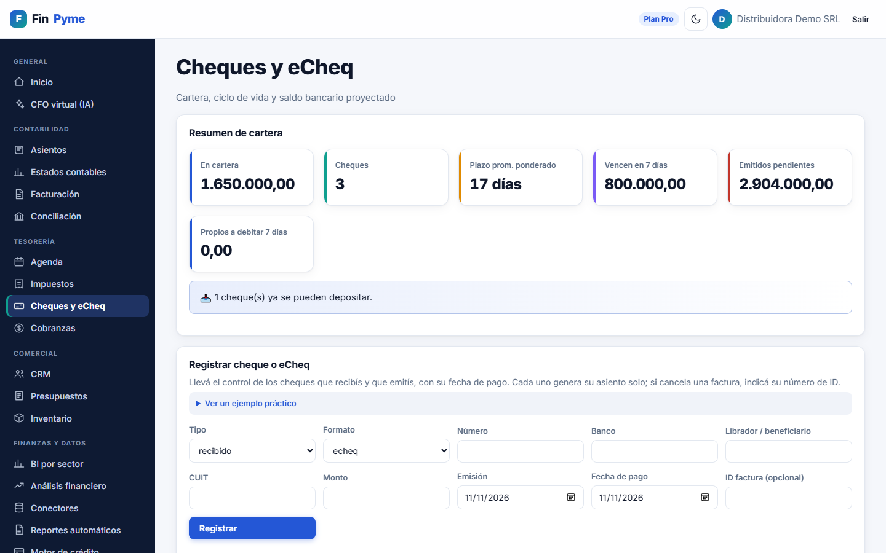 **Cheques y eCheq**: cartera, vencimientos, endosos y descuentos con su asiento | 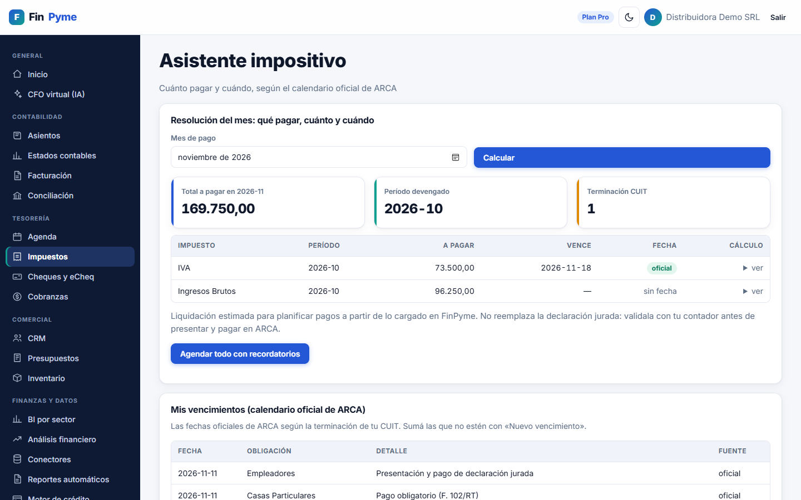 **Impuestos**: liquidación estimada de IVA e Ingresos Brutos y calendario de ARCA |
| 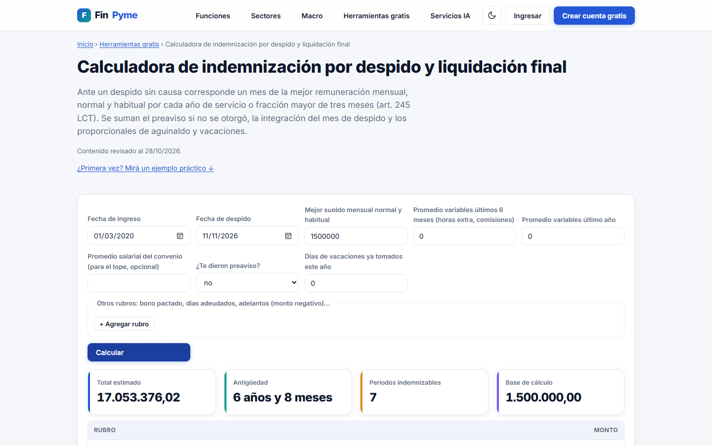 **31 calculadoras públicas** (sueldo neto, indemnización, inflación, dólar…) que atraen tráfico orgánico | 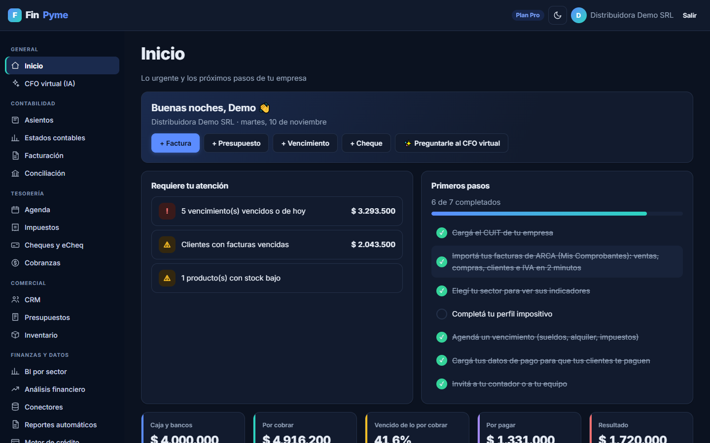 **Modo oscuro** y diseño adaptable |

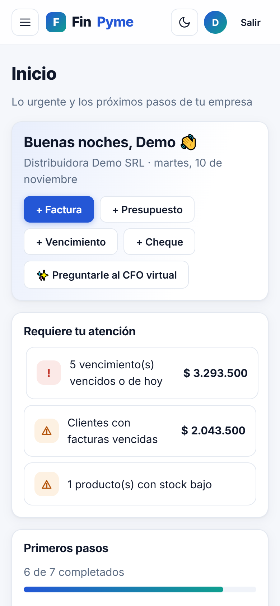 Instalable en el celular como app (PWA)

## Funcionalidades

**Contabilidad e impuestos**
- Partida doble con importes en decimal exacto, numeración correlativa, cierre de períodos y de ejercicio, y anulación por contraasiento.
- Asientos automáticos desde facturas, cobros, pagos y cheques.
- Importación de comprobantes de ARCA y **lectura del QR de una factura en foto o PDF** (OpenCV), sin cargar nada a mano.
- Conciliación bancaria que **aprende reglas** de categorización.
- Ajuste por inflación contable (RT 6) con el IPC oficial.
- Liquidación estimada de IVA, Ingresos Brutos, anticipos de Ganancias y cargas sociales, con el calendario oficial de vencimientos.

**Tesorería y cobranzas**
- Flujo de caja proyectado, agenda de vencimientos y cartera de cheques y eCheq.
- Consulta en vivo de la **Central de Deudores del BCRA** y cheques rechazados.
- Avisos por email, **WhatsApp (Cloud API de Meta)** y notificaciones push; estado de cuenta compartible con cada cliente.

**Análisis y crédito**
- Motor de crédito con scorecard experto que se **calibra con los desenlaces reales** de la cartera, y modelo de ML opcional.
- Gestión de riesgos financieros (FRM), ratios, VAN/TIR y escenarios macroeconómicos.
- BI por sector con 13 rubros, tableros propios, alertas y pronósticos de ventas (statsmodels).

**Plataforma**
- Multiempresa con roles (administrador, contador, analista, lector), pensado para estudios contables.
- Suscripciones con Mercado Pago y planes freemium.
- **Conector MCP**: ChatGPT o Claude pueden usar las calculadoras de FinPyme dentro de una conversación.
- Asistente de IA (CFO virtual) que responde con los datos reales de la empresa mediante herramientas.
- Instalador para Windows con Python incluido, copias de seguridad diarias y desinstalador.

## Arquitectura

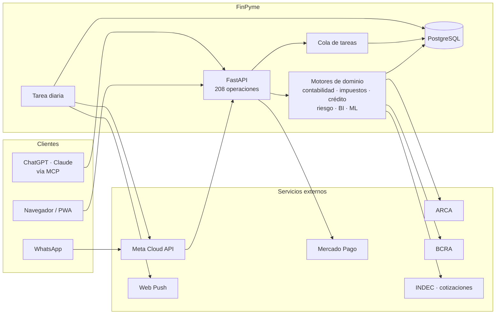

## Ingeniería y calidad

| | |
|---|---|
| **Tests** | 271 tests automáticos con pytest, que corren contra SQLite y PostgreSQL 17 en integración continua (GitHub Actions) |
| **Recorrida en navegador** | Playwright recorre la app completa en cada cambio, con auditoría de accesibilidad (axe-core, WCAG 2.1 AA) y prueba de navegación con teclado |
| **Base de datos** | Migraciones con Alembic verificadas en CI; respaldos lógicos que se validan restaurándolos en una base temporal |
| **Seguridad** | Sesión en cookie httpOnly con protección CSRF, verificación en dos pasos opcional, secretos cifrados, límite de intentos, CSP estricta, listas blancas contra SSRF y webhooks firmados |
| **Operación** | Logs estructurados en JSON, monitoreo de errores con Sentry, chequeos de salud, cola de tareas para procesos pesados y despliegue con un archivo de configuración |
| **SEO** | Páginas renderizadas en el servidor, datos estructurados (schema.org), sitemap y contenido preparado para buscadores con IA |

**En números:** ~18.000 líneas de Python · 208 operaciones de API · 31 herramientas públicas · 16 migraciones de base de datos.

## Stack

Python 3.13 · FastAPI · SQLAlchemy 2 · Alembic · PostgreSQL · pandas · NumPy · SciPy · scikit-learn · statsmodels ·
OpenCV · Jinja2 · JavaScript sin frameworks · Chart.js · Playwright · GitHub Actions · Render

## Código

El código fuente es privado. Si querés verlo o conversar sobre el proyecto, escribime por [LinkedIn](https://www.linkedin.com/) o por [email](mailto:tu-email@ejemplo.com).

© 2026 · Todos los derechos reservados. Las capturas usan una empresa ficticia con datos de ejemplo.
